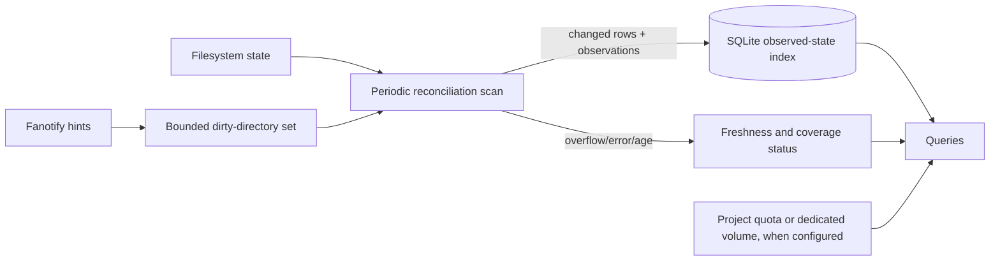

# Dux architecture decision: reconciliation-first

**Decision status:** selected source default for the production-readiness work;
`dux daemon` drains fanotify as hints,
schedules periodic scans, and merges complete observations into the existing
v7 database with value-guarded changed-row writes. It is not qualified for
production-scale performance or sustained churn. This supersedes the earlier event-journal-first
redesign in this file and the corresponding draft in
[`DEVELOPMENT_SPECIFICATION.md`](DEVELOPMENT_SPECIFICATION.md).

`--event-apply` retains the legacy mode for controlled comparison/rollback; the
installed production service is unchanged until rollout gates pass. The new
mode does not resolve per-event handles or apply path mutations. It performs an
initial atomic baseline and then in-place observations every 15 minutes; overflow or
malformed records request reconciliation, while events observed during a scan
keep the view visibly stale and defer the next attempt to the fixed cadence.
This remains experimental. Changed-row reconciliation is implemented, but
the production-shaped 1.37M-entry run has only one static VPS2 sample; quota
behavior, concurrent-churn recovery, and sustained performance remain
unqualified. See the current measurements in
[`PRODUCTION_READINESS_STATUS.md`](../PRODUCTION_READINESS_STATUS.md).

## Product contract

Dux will index the **last observed filesystem state**, not promise an exact,
linearizable view of a busy filesystem at the current instant. Every displayed
index value must carry usable freshness information: last observed time, scan
generation, scan progress, and any coverage errors. A successful live walk is
not an atomic snapshot; even fields from one Linux `stat()` result can represent
different moments during concurrent changes ([`stat(2)`](https://man7.org/linux/man-pages/man2/stat.2.html)).

The initial freshness target is a full observation of every supported local
filesystem at least every **15 minutes**, subject to measurement. That is an
SLO, not a guarantee under arbitrary overload. If scan time, pressure guards,
mount failures, or permissions prevent the target, Dux reports the age and the
missed target. It must not call stale data current. A truly point-in-time view
requires a filesystem snapshot or an equivalent filesystem-specific primitive.

## Why this is the selected design

The installed production index has remained dirty for hours after fanotify
overflows. Event delivery is useful for low-latency hints, but it is not a
durable source of truth. A periodic scan makes event loss recoverable without
requiring event replay to prove every path update. Dux continues to bound its
resources and report when it cannot meet freshness.

Earlier runs measured a 10M-inode scan at **1,004.445 s** and **868 s**;
linear extrapolation to 1.37M entries suggested **2.0–2.3 minutes**. A current
release-profile scan-first run on VPS2 observed **154 s** for the initial scan
and **129 s** for the following unchanged in-place scan, consistent with that
estimate. The second pass was cache-warm, so the difference is not an A/B
performance result. This was a static synthetic ext4 tree under a one-core
quota, not a production guarantee; mount mix, concurrent churn, disk peak, and
long-run cadence remain unqualified.

## Architecture

### Scan and update

- A full walk of each configured filesystem runs on a cadence chosen from the
  measured freshness SLO. Hinted directories receive priority; the full walk
  remains the backstop for missed hints, restarts, and overflow.
- Scanning compares the current stat tuple with the existing row and writes
  only changed metadata. Traversal is still O(number of entries); unchanged
  rows reduce SQLite writes, not directory enumeration or stat work.
- A directory's old child rows may be removed only after that directory was
  completely and successfully enumerated. A failed, unreadable, or interrupted
  directory scan preserves its prior rows and records incomplete coverage.
- Updates carry per-directory scan generation and observation time. The live
  root view may combine observations from different moments; Dux labels it
  last-observed and never presents it as a single atomic snapshot.
- During the v7 transition, atomic scans persist both the v7 path graph and the
  v6 compatibility projection. The watcher still updates only v6 tables, so
  `paths` and `dir_totals` describe the last completed scan and can lag event
  updates. No query or event path may treat them as current until v7 event
  maintenance and freshness reporting are implemented.
- The scheduler may defer work under critical pressure, but deferral cannot
  become a permanent circuit breaker. Retry is automatic with bounded backoff;
  freshness age continues increasing while work is deferred.

### Event hints and overflow

- Fanotify is an optimization for choosing what to scan sooner. The current
  scan-first reader drains raw record chunks on a dedicated thread into a
  bounded 128-chunk channel (32 KiB per chunk). It never waits for queue
  capacity, handle resolution, or database work. A full channel discards that
  chunk, records explicit loss, and requests a full observation. The coordinator
  validates DFID_NAME records and coalesces at most 32 distinct parent handles
  per parse slice. A separate resolver thread performs bounded handle-to-root
  checks; both work queues are bounded, and saturation is recorded as loss.
  Ordinary unresolvable scopes leave the view stale for the fixed scan cadence
  rather than forcing repeated immediate scans. Kernel overflow and userspace
  pipeline loss still request a follow-up observation after an active scan.
- Repeated hints coalesce by filesystem and directory identity. If a parent
  cannot be resolved safely, widen to a known ancestor or the whole filesystem.
  The current implementation widens to a full-root observation; subtree
  prioritization has not been implemented. On shutdown the reader is stopped
  and joined before exit, and the next startup is required to observe the tree.
- A kernel queue overflow schedules a full scan of the affected filesystem as
  soon as resource guards allow it. It can make the view stale until that scan
  completes, but cannot permanently prevent later scans from repairing it.
- Hints cannot reduce the number of kernel notifications produced by a
  filesystem mark. On a build filesystem that still floods the queue, Dux must
  stop per-file watching there or place that workload on a separate mount.
- Do not add a durable event journal to the default mode. Reconsider one only
  for a separately specified low-latency profile whose measured restart-loss
  requirement justifies another storage and recovery subsystem.

### Identity and query semantics

- Preserve distinct visible paths and physical inode allocation identities.
  Schema v7 path instances are a prerequisite for a generally correct
  incremental reconciler: v6's `(dev,inode)` parent keys cannot preserve
  distinct visible paths through mount aliases. A v6-only prototype may be
  useful for a constrained single-filesystem benchmark, but cannot qualify the
  all-supported-mount correctness contract.
- Keep hardlink allocation deduplication, non-UTF8 path identity, inode reuse
  protection, and explicit partial-coverage results.
- Report freshness per filesystem and directory scope. A pending hint is not
  itself proof of loss; a completed scan observation is not proof of a
  point-in-time snapshot. Only a snapshot-backed result may claim snapshot
  consistency.
- Keep the existing “dirty”/uncertain state for actual traversal failures,
  missing mounts, unsupported filesystem coverage, or accounting errors. For
  ordinary event loss, report stale age and scheduled reconciliation instead
  of a permanently dirty index.

## Managed build trees

Project quotas are an optional accelerator for explicitly managed trees. Linux
`quotactl` supports project quota accounting ([`quotactl(2)`](https://man7.org/linux/man-pages/man2/quotactl_fd.2.html)). XFS can assign project IDs recursively to an existing directory tree and inherit them for new files ([`xfs_quota(8)`](https://man7.org/linux/man-pages/man8/xfs_quota.8.html)); ext4 project IDs and inheritance have filesystem feature and directory-flag requirements ([`ext4(5)`](https://man7.org/linux/man-pages/man5/ext4.5.html), [`chattr(1)`](https://man7.org/linux/man-pages/man1/chattr.1.html)).

Quota totals provide block and inode usage, not per-file paths or large-file
results. They do not suppress fanotify notifications by themselves. Dux only
removes the event/index cost if it excludes the managed mount/tree from
per-file tracking and serves its quota total instead. A dedicated filesystem
is easiest to account for with `statfs` only when it contains just the managed
workload; `statfs` reports the filesystem, not an arbitrary subtree.

The inspected production root is ext4 on LVM and does **not** currently have
the ext4 `project` or `quota` features. Enabling ext4 quota features on that
root requires an offline maintenance operation in the documented procedure
([RHEL ext4 quota setup](https://docs.redhat.com/en/documentation/red_hat_enterprise_linux/10/html/managing_file_systems/limiting-storage-space-usage-on-ext4-with-quotas)). Do not modify the production root for this redesign. First check available LVM extents and qualify a separate disposable filesystem; whether a dedicated production LV is feasible remains unverified.

## Ordered implementation and gates

| Stage | Work | Exit evidence |
| --- | --- | --- |
| 0. Restore automatic recovery and diagnose throttling | Qualify bounded automatic retry for the existing reconciliation circuit, then compare CPU targets on a controlled trace while holding event rate, queue size, cgroup quota, and workload constant. | Repeated runs show retry convergence or a clear terminal cause, and report event rates, overflows, CPU/I/O pressure, and scan recovery. No production setting changes without a qualified rollback. |
| 1. Establish schema-v7 path identity | Persist distinct path instances and mount identity; migrate and verify aliases, hardlinks, non-UTF8 names, inode reuse, and history while preserving rollback. | Independent path/object/rollup oracle agrees before the incremental reconciler is built on this schema. |
| 2. Implement periodic full reconciliation with changed-row writes | Add last-observed timestamps, per-scope generation/progress, automatic periodic scans, and changed-row writes. Failed scopes preserve prior rows and remain visibly incomplete. A scan may publish last-observed data without waiting for event replay; queued events remain hints for follow-up work. | Under quiescent fixtures, paths, allocations, and rollups exactly match an independent oracle. Under concurrent churn, no false “current/exact” state appears; after churn stops, the next complete scan converges. |
| 3. Add bounded event hints | Reduce the reader to coalescing directory/filesystem hints. Overflow widens repair scope and schedules scans; it does not stop the scan scheduler. | Forced kernel overflow and userspace hint-capacity saturation both converge without manual circuit reset. Memory stays within budget; unresolved scopes remain visible. |
| 4. Measure the 15-minute target | Run the 1.37M-entry production-shaped fixture and then representative production workload. Measure full-cycle time, per-scope maximum observation age, read/stat rate, CPU, I/O, memory, SQLite writes, and missed cycles. | Every monitored scope meets the agreed age SLO for 72 hours under the target workload, or the product exposes a revised SLO with evidence. If the scan takes 2.3 minutes, schedule and measure the remaining interval so worst-case path age—not just scan start interval—meets the 15-minute target. |
| 5. Add build-tree quota/volume adapters | On disposable ext4 and XFS fixtures, compare project quota block/inode counters against independent tree totals, including creation, deletion, rename, hardlinks, and project-boundary operations. | Exact documented counters under supported operations; clear behavior for unsupported filesystems and paths. No production filesystem feature or mount change is part of this stage. |
| 6. Integrate and qualify release | Preserve package/security gates, disk limits, service rollback, and the existing fault/scale matrix. Run the exact release artifact. | P0, 100k/1m/10m, overflow/recovery, low-disk, security/package lifecycle, 72-hour endurance, and 24-hour canary pass with source/binary/config/fixture identities recorded. |

## Explicitly deferred

The default scan-first design does not include a durable event journal, a
provisional event overlay, a custom kernel module, mandatory eBPF, or a claim of
lossless real-time updates. A separate snapshot-backed profile can be designed
if a use case requires point-in-time exactness. Treemap/UI changes, history
tiering, cleanup execution, and query-plan work remain product work unless
measurements show they block the freshness or recovery contract.

The queue-aware CPU governor, stale-parent handling, retry backoff, and status
telemetry in the current working tree belong to the legacy event-apply path.
They are not deployed and are not the selected long-term architecture. Current
source tests and strict default-feature Clippy passed on VPS2; the ext4 stale-
parent integration case passed there separately. The broader Python sweep had
three package-build timeouts under a 5% CPU cap. These checks are regression
evidence for the current code, not scan-first qualification or release evidence.
