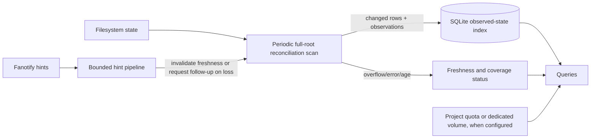

# Dux architecture decision: reconciliation-first

**Decision status:** selected source default for the production-readiness work;
`dux daemon` drains fanotify as lossy invalidation hints,
schedules periodic full-root scans, and merges complete observations into the existing
v7 database with value-guarded changed-row writes. Resolved directory hints
now bias traversal order within the next full-root scan; they do not enable
scoped scans or change coverage requirements. It is not qualified for
production-scale performance or sustained churn. This supersedes the earlier event-journal-first
redesign in this file and the corresponding draft in
[`DEVELOPMENT_SPECIFICATION.md`](DEVELOPMENT_SPECIFICATION.md).

`--event-apply` retains the legacy mode for controlled comparison/rollback; the
installed production service is unchanged until rollout gates pass. The new
mode does not resolve per-event handles or apply path mutations. It performs an
initial atomic baseline and then in-place observations on a 15-minute cadence.
Overflow and malformed records mark the last-observed view stale without
pulling the next observation forward; explicit requests and failed observations
retain their retry behavior.
This remains experimental. Changed-row reconciliation is implemented. The
exact current candidate passed one 1.37M-path ext4 scale profile on VPS2:
196.3 seconds at a 50% CPU quota and 154 MiB scan RSS. This is one profile,
not an age-SLO or endurance result; 10M scale, representative production
workload, and sustained performance remain unqualified. See the current measurements in
[`PRODUCTION_READINESS_STATUS.md`](../PRODUCTION_READINESS_STATUS.md).

## Product contract

Dux will index the **last observed filesystem state**, not promise an exact,
linearizable view of a busy filesystem at the current instant. Every displayed
index value must carry usable freshness information: last observed time, scan
generation, scan progress, and any coverage errors. A successful live walk is
not an atomic snapshot; even fields from one Linux `stat()` result can represent
different moments during concurrent changes ([`stat(2)`](https://man7.org/linux/man-pages/man2/stat.2.html)).

The initial freshness target is a full observation of every supported local
filesystem at least every **15 minutes**, subject to measurement. That is an
SLO, not a guarantee under arbitrary overload. If scan time, pressure guards,
mount failures, or permissions prevent the target, Dux reports the age and the
missed target. It must not call stale data current. A truly point-in-time view
requires a filesystem snapshot or an equivalent filesystem-specific primitive.

## Why this is the selected design

The installed production index has remained dirty for hours after fanotify
overflows. Event delivery is useful for low-latency hints, but it is not a
durable source of truth. A periodic scan makes event loss recoverable without
requiring event replay to prove every path update. In scan-first mode, hint
loss marks the last-observed view stale; it does not pull a full-root scan
forward. Only an explicit operator request, a failed/incomplete observation,
or a failed accounting check can request an earlier retry. Dux continues to
bound its resources and report when it cannot meet freshness.

Earlier runs measured a 10M-inode scan at **1,004.445 s** and **868 s**;
linear extrapolation to 1.37M entries suggested **2.0–2.3 minutes**. A current
release-profile scan-first run on VPS2 observed **154 s** for the initial scan
and **129 s** for the following unchanged in-place scan, consistent with that
estimate. The second pass was cache-warm, so the difference is not an A/B
performance result. This was a static synthetic ext4 tree under a one-core
quota, not a production guarantee; mount mix, concurrent churn, disk peak, and
long-run cadence remain unqualified.

## Architecture

### Scan and update

- A full walk of each configured filesystem runs on a cadence chosen from the
  measured freshness SLO. Resolved in-root hints prioritize branches within
  that full traversal; they never select a partial subtree or reduce coverage.
  The full walk remains the only reconciliation path.
- Scanning compares the current stat tuple with the existing row and writes
  only changed metadata. Traversal is still O(number of entries); unchanged
  rows reduce SQLite writes, not directory enumeration or stat work.
- A directory's old child rows may be removed only after that directory was
  completely and successfully enumerated. A failed, unreadable, or interrupted
  directory scan preserves its prior rows and records incomplete coverage.
- Updates carry per-directory scan generation and observation time. The live
  root view may combine observations from different moments; Dux labels it
  last-observed and never presents it as a single atomic snapshot.
- During the v7 transition, atomic scans persist both the v7 path graph and the
  v6 compatibility projection. The watcher still updates only v6 tables, so
  `paths` and `dir_totals` describe the last completed scan and can lag event
  updates. No query or event path may treat them as current until v7 event
  maintenance and freshness reporting are implemented.
- The scheduler may defer work under critical pressure, but deferral cannot
  become a permanent circuit breaker. Retry is automatic with bounded backoff;
  freshness age continues increasing while work is deferred.

### Event hints and overflow

- Fanotify is an optimization for prioritizing branches within the next scan. The current
  scan-first reader drains raw record chunks on a dedicated thread into a
  bounded 128-chunk channel (32 KiB per chunk). It never waits for queue
  capacity, handle resolution, or database work. A full channel discards that
  chunk and records explicit loss. The next observation remains on its fixed
  cadence. The coordinator
  validates DFID_NAME records and coalesces at most 32 distinct parent handles
  per parse slice. A separate resolver thread performs bounded handle-to-root
  checks; both work queues are bounded, and saturation is recorded as loss.
  Ordinary unresolvable scopes leave the view stale for the fixed scan cadence
  rather than forcing repeated immediate scans. Kernel overflow and userspace
  pipeline loss during an active scan also leave the next observation on its
  fixed cadence.
- Repeated hints coalesce by filesystem and directory identity. If a parent
  cannot be resolved safely, widen to a known ancestor or the whole filesystem.
  The current implementation widens to a full-root observation; subtree
  prioritization has not been implemented. On shutdown the reader is stopped
  and joined before exit, and the next startup is required to observe the tree.
- A kernel queue overflow marks the view stale. The next full-root observation
  stays on the fixed 15-minute cadence; the event stream is not the truth and
  cannot force repeated scans. An operator can still request an immediate
  observation, and failed or incomplete observations retain their bounded
  retry policy.
- Hints cannot reduce the number of kernel notifications produced by a
  filesystem mark. On a build filesystem that still floods the queue, Dux must
  stop per-file watching there or place that workload on a separate mount.
- Do not add a durable event journal to the default mode. Reconsider one only
  for a separately specified low-latency profile whose measured restart-loss
  requirement justifies another storage and recovery subsystem.

### Identity and query semantics

- Preserve distinct visible paths and physical inode allocation identities.
  Schema v7 path instances are a prerequisite for a generally correct
  incremental reconciler: v6's `(dev,inode)` parent keys cannot preserve
  distinct visible paths through mount aliases. A v6-only prototype may be
  useful for a constrained single-filesystem benchmark, but cannot qualify the
  all-supported-mount correctness contract.
- Keep hardlink allocation deduplication, non-UTF8 path identity, inode reuse
  protection, and explicit partial-coverage results.
- Report freshness per filesystem and directory scope. A pending hint is not
  itself proof of loss; a completed scan observation is not proof of a
  point-in-time snapshot. Only a snapshot-backed result may claim snapshot
  consistency.
- Keep the existing “dirty”/uncertain state for actual traversal failures,
  missing mounts, unsupported filesystem coverage, or accounting errors. For
  ordinary event loss, report stale age and scheduled reconciliation instead
  of a permanently dirty index.

## Managed build trees

Project quotas are an optional accelerator for explicitly managed trees. Linux
`quotactl` supports project quota accounting ([`quotactl(2)`](https://man7.org/linux/man-pages/man2/quotactl_fd.2.html)). XFS can assign project IDs recursively to an existing directory tree and inherit them for new files ([`xfs_quota(8)`](https://man7.org/linux/man-pages/man8/xfs_quota.8.html)); ext4 project IDs and inheritance have filesystem feature and directory-flag requirements ([`ext4(5)`](https://man7.org/linux/man-pages/man5/ext4.5.html), [`chattr(1)`](https://man7.org/linux/man-pages/man1/chattr.1.html)).

Quota totals provide block and inode usage, not per-file paths or large-file
results. They do not suppress fanotify notifications by themselves. Dux only
removes the event/index cost if it excludes the managed mount/tree from
per-file tracking and serves its quota total instead. A dedicated filesystem
is easiest to account for with `statfs` only when it contains just the managed
workload; `statfs` reports the filesystem, not an arbitrary subtree.

The inspected production root is ext4 on LVM and does **not** currently have
the ext4 `project` or `quota` features. Enabling ext4 quota features on that
root requires an offline maintenance operation in the documented procedure
([RHEL ext4 quota setup](https://docs.redhat.com/en/documentation/red_hat_enterprise_linux/10/html/managing_file_systems/limiting-storage-space-usage-on-ext4-with-quotas)). Do not modify the production root for this redesign. First check available LVM extents and qualify a separate disposable filesystem; whether a dedicated production LV is feasible remains unverified.

## Ordered implementation and gates

| Stage | Work | Exit evidence | Current state |
| --- | --- | --- | --- |
| 0. Restore automatic recovery and diagnose throttling | Qualify bounded automatic retry for the existing reconciliation circuit, then compare CPU targets on a controlled trace while holding event rate, queue size, cgroup quota, and workload constant. | Repeated runs show retry convergence or a clear terminal cause, and report event rates, overflows, CPU/I/O pressure, and scan recovery. No production setting changes without a qualified rollback. | Scan-first retries no longer use the legacy permanent circuit. One CPU target comparison remains open. |
| 1. Establish schema-v7 path identity | Persist distinct path instances and mount identity; migrate and verify aliases, hardlinks, non-UTF8 names, inode reuse, and history while preserving rollback. | Independent path/object/rollup oracle agrees before the incremental reconciler is built on this schema. | Implemented in candidate source and covered by migration/invariant tests. Production remains on schema v6; rollout and rollback are unqualified. |
| 2. Implement periodic full reconciliation with changed-row writes | Add last-observed timestamps, per-scope generation/progress, automatic periodic scans, and changed-row writes. Failed scopes preserve prior rows and remain visibly incomplete. A scan may publish last-observed data without waiting for event replay; queued events remain hints for follow-up work. | Under quiescent fixtures, paths, allocations, and rollups exactly match an independent oracle. Under concurrent churn, no false “current/exact” state appears; after churn stops, the next complete scan converges. | Default source mode performs 15-minute full-root observations and value-guarded changed-row writes. On 2026-11-08 the exact final candidate passed two 100k ext4 / 20k mixed-mutation runs (20 exact checkpoints total) at a 25% CPU quota. Maximum batch convergence was 141.997 s. One run's midpoint observation was correctly marked incomplete during concurrent inode reuse and recovered by automatic retry; the second run had no uncertain checkpoint. It also passed one 1.37M-path exact ext4 scale profile at a 50% CPU quota. These are fixture results, not a freshness-SLO or sustained-churn qualification. 10M scale, representative production workload, and multi-day endurance remain open. Evidence: [first churn run](qualification/scan-first-self-filter-20261108/final-churn-report.json), [repeat](qualification/scan-first-self-filter-20261108/repeat-churn-report.json), [1.37M scale](qualification/scan-first-self-filter-20261108/scale-1370k-report.json). |
| 3. Add bounded event hints | Reduce the reader to bounded directory/filesystem hints. Overflow widens repair scope and schedules scans; it does not stop the scan scheduler. Resolved in-root hints bias branch order in a full scan; they never narrow required coverage. | Forced kernel overflow and userspace hint-capacity saturation converge without manual circuit reset. Memory stays within budget; unresolved scopes remain visible. Traversal-order benefit is measured on a fixture with a delayed hinted subtree. | The reader now filters well-formed records from Dux's own PID before they enter the bounded ring; malformed input and kernel overflow records remain fail-closed. Two targeted tests cover self/mixed/overflow/malformed records. The exact final 2026-11-08 100k/20k ext4 run recorded 50,498 events, `dropped=0`, and `uncertain=false` at all ten exact gates; one deliberate scan/mutation overlap produced an incomplete scan and recovered on automatic retry. The same exact binary passed a forced ext4 overflow: 18,432 creates overflowed a 16,384-event queue, triggered a full observation and accounting verification, and recovered to an exact filesystem match in 7.147 s. A prior unfiltered f5 candidate failed to converge within 240 s and logged repeated userspace ring overflows, supporting self-event queue pressure as a cause; the comparison does not prove it was the only cause. Hints still do not provide lossless delivery or reduce the full-walk requirement. Other filesystems, sustained repeated overflow, and traversal-order latency benefit remain open. Evidence: [patched churn report](qualification/scan-first-self-filter-20261108/final-churn-report.json), [forced overflow report](qualification/scan-first-self-filter-20261108/final-overflow-report.json), [unfiltered startup failure](qualification/scan-first-self-filter-20261108/unfiltered-f5c84b3-retry240-report.json), [earlier overflow run](qualification/scan-first-overflow-20261107/report.json). |
| 4. Measure the 15-minute target | Run the 1.37M-entry production-shaped fixture and then representative production workload. Measure full-cycle time, per-scope maximum observation age, read/stat rate, CPU, I/O, memory, SQLite writes, and missed cycles. | Every monitored scope meets the agreed age SLO for 72 hours under the target workload, or the product exposes a revised SLO with evidence. If the scan takes 2.3 minutes, schedule and measure the remaining interval so worst-case path age—not just scan start interval—meets the 15-minute target. | Sixteen live VPS2 scan-first observations at ~1.96M staged path instances completed with zero coverage issues and passing accounting checks. The first seven starts were 15 minutes apart. Completion gaps were 13m48s, 14m51s, 15m39s, 14m47s, 17m00s, 14m43s, 26m37s, 14m14s, 17m12s, 13m57s, 15m19s, 15m50s, and 15m39s, 14m15s, and 14m08s; seven of fifteen exceed 15 minutes. One 15:40 attempt failed after 7m58s with three inode-incarnation conflicts and retained the prior index; its 15:49 bounded retry completed after 9m48s with zero coverage issues and passed accounting. The following scan started 16:04:07 and completed 16:13:09 after 9m02s, with zero coverage issues and accounting passed at 16:14:25. No kernel overflows or dropped updates were reported. The 16:19:07 scheduled attempt failed at 16:22:54 with one inode-incarnation conflict; the previous index was retained. Its bounded retry started at 16:23:54, completed at 16:30:21 with zero coverage issues, and passed accounting at 16:31:43. This repeats the busy-host inode-reuse race observed at 15:40; bounded retry recovers, but it stretches observation gaps beyond the cadence. The next scheduled scan began at 16:38:54 and completed at 16:44:18 with zero coverage issues; accounting passed at 16:45:42, and the completion gap was 13m57s. A further scan started at 16:53:54 and completed at 16:59:37 with zero coverage issues, 1,578 vanished paths discarded, two identities revalidated, and accounting passed at 17:00:49. Its completion gap was 15m19s. The latest observation started at 17:08:54 and completed at 17:15:27 in 6m33s, with 1,743,558 files, 213,882 directories, zero coverage issues, and accounting passed at 17:16:36. It followed a 15m50s completion gap. The fourteenth started 17:23:54 and completed at 17:31:06 (7m12s), covering 1,746,296 files and 214,213 directories with zero coverage issues; accounting passed at 17:32:37. Its completion gap was 15m39s. The fifteenth started at 17:38:55 and completed at 17:45:21 in 6m26s, with 1,748,968 files and 214,539 directories, zero coverage issues, and accounting passed at 17:46:34; its completion gap was 14m15s. These completion-to-completion gaps are not per-path freshness measurements: `last_scan_ts` records completion, and the schema does not store per-path last-observed timestamps. Maximum individual-path age remains unmeasured. A 422-second partial cgroup window of the fourteenth observation recorded 331 CPU-seconds, 2.01 GiB read, 1.80 GiB written, 2.00-GiB peak memory, and 204 memory-high events without OOM; it omitted the first 1m58s of the scan and includes accounting, so it is not full-cycle cost. This is early live evidence, not an SLO pass. The 72-hour cadence, 10M scale, repeated variance, per-path freshness, and scan optimization/resource/SLO choice remain open. Production VPS1 remains on the old event-apply daemon. See the [17:33 readiness evidence](../PRODUCTION_READINESS_STATUS.md#scan-first-runtime-cycle-and-fresh-dependency-audit--2026-11-10-1616-utc), the [1.37M scale report](qualification/scan-first-self-filter-20261108/scale-1370k-report.json), and [current churn report](qualification/scan-first-self-filter-20261108/final-churn-report.json). |
| 5. Add build-tree quota/volume adapters | On disposable ext4 and XFS fixtures, compare project quota block/inode counters against independent tree totals, including creation, deletion, rename, hardlinks, and project-boundary operations. | Exact documented counters under supported operations; clear behavior for unsupported filesystems and paths. No production filesystem feature or mount change is part of this stage. | Deferred; no quota adapter is implemented. |
| 6. Integrate and qualify release | Preserve package/security gates, disk limits, service rollback, and the existing fault/scale matrix. Run the exact release artifact. | P0, 100k/1m/10m, overflow/recovery, low-disk, security/package lifecycle, 72-hour endurance, and 24-hour canary pass with source/binary/config/fixture identities recorded. | Not release-qualified. The current GNU release binary passed one 1M and one 1.37M scale profile plus one ext4 overflow fixture; the packaged static-musl artifact has not been tested with these current-source workloads. 10M, the complete P0/fault matrix, 72-hour soak, package rollback, and production canary remain open. |

### Additional inode-reuse requirement from VPS2 (2026-11-08)

The package-101 live run exposed a remaining reconciliation failure mode under
real host churn. A 1.44M-entry ext4 walk at 12:12:14 completed at 12:15:03 but
reported 45 conflicting inode incarnations; its retry at 12:23:03 completed at
12:26:29 with another 35. The preceding 11:50 cadence scan had reported 155.
In all incomplete cases, Dux correctly retained the previous accepted index
and marked it dirty. The scheduler is functioning, but the scan does not
converge while this host continues reusing inode numbers during walks. At
12:30 the service had accumulated 1,213 CPU seconds, 11.2 GB read, and 17.5 GB
written in one hour, so scan overhead is also a release blocker.

The current compatibility `inodes` table has primary key `(dev_id,inode)`,
while v7 `paths` also store `birth_ns`. The scanner's
`count_conflicting_inode_incarnations` groups by `(dev,inode)` and rejects a
walk if birth times differ. Removing this check alone is unsafe: a scan may
have observed a path before unlink and a later path after inode reuse, leaving
a stale path in the staged graph, and the compatibility allocation row cannot
represent both incarnations. A correctness fix must both key allocation and
hardlink identity by incarnation and revalidate/rescan affected parent paths
after a detected race. If the affected paths cannot be proven stable within a
bounded retry, the scan must remain incomplete. Snapshot-backed scans are the
alternative when a point-in-time tree is required.

Required regression gate before changing this behavior: a deterministic ext4
fixture must force unlink/reuse of one inode number at a different path during
a scan, then compare every published path, incarnation, allocation, and
recursive total with an independent post-scan filesystem oracle. Add the same
case under repeated reuse and forced userspace hint loss. The candidate must
either converge safely or remain explicitly stale; it may never publish the
stale first path as current. VPS2 runtime evidence is in
[`qualification/scan-first-fixed-cadence-20261108/`](qualification/scan-first-fixed-cadence-20261108/).

The first deterministic fail-closed regression now exists in
`scan::tests::in_place_scan_keeps_previous_index_when_ext4_reuses_inode_mid_walk`.
It injects the race after stat and passed ten consecutive runs on the local
ext4 host; the test proves the previous index remains published and dirty, and
that the unverified replacement path is withheld. It is a test-only seam and
does not change release behavior. The independent post-scan oracle, repeated
reuse, and forced-hint-loss variants remain to be implemented before changing
the conflict policy. See
[`scan-first-inode-reuse-race-20261108/`](qualification/scan-first-inode-reuse-race-20261108/).

Follow-up to the 20:05 VPS2 conflict (2026-11-08): the working tree now
revalidates a still-present non-directory leaf after confirming its staged
ancestor chain and current file type. It refreshes that leaf's current
identity/allocation in scan staging. A deterministic ext4 test recreates the
old name with a different inode while reusing the old inode under another
name; a direct filesystem oracle checks every fixture path plus root totals,
and the case passed 10/10 runs. This is a narrow, fail-closed convergence
improvement, not the full incarnation-keyed allocation/schema design above.
The VPS2 daemon remains on the prior binary; its subsequent retry also found
one conflict and the 5-minute canary failed the 20-minute observation-age
limit. An additional regression test now verifies that an ambiguous directory
replacement remains a coverage error even if revalidating a sibling file
removes the SQL conflict group; unresolved candidates are counted separately
so that clearing one conflict cannot create a false-clean scan. The latest
local source passes 317 default-feature and 320 all-feature Rust tests (2
ignored in each), plus 323 Python tests. Current llvm-cov line coverage is
61.58% overall and 48.61% for the scanner. Runtime proof of this code change
is still required.

## Explicitly deferred

The default scan-first design does not include a durable event journal, a
provisional event overlay, a custom kernel module, mandatory eBPF, or a claim of
lossless real-time updates. A separate snapshot-backed profile can be designed
if a use case requires point-in-time exactness. Treemap/UI changes, history
tiering, cleanup execution, and query-plan work remain product work unless
measurements show they block the freshness or recovery contract.

The queue-aware CPU governor and stale-parent handling primarily support the
legacy event-apply path; they are not the selected long-term architecture. The
reconciliation-first path also has a bounded reader, resolver, retry policy,
and last-observed status semantics. On 2026-11-07, the candidate passed 294
Rust tests (2 ignored), 36 Python readiness tests, strict all-target/all-feature
Clippy, formatting, and one forced ext4 overflow recovery run. This is candidate
evidence only. It does not qualify other kernels/filesystems, scale budgets,
endurance, packaging, or production rollout.
