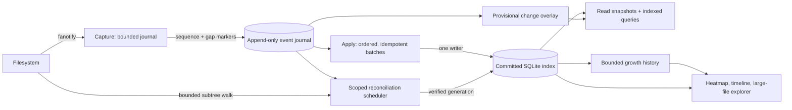

# Dux architecture evolution

Implementation requirements and acceptance gates are consolidated in
[`DEVELOPMENT_SPECIFICATION.md`](DEVELOPMENT_SPECIFICATION.md). Read its journal,
snapshot, overflow-scoping and size-semantics limits alongside this design.

## Goal

Keep the index as fresh as the available filesystem change evidence permits, bound the cost of recovering from gaps, and make storage growth visible and manageable without surprising deletion. The design must remain correct under event loss, daemon restart, rename races, hard links, and disk pressure. It must not label an uncertain or provisional view as exact.

## Current pressure points

The previous event parser resolved an indexed name with a SQLite lookup for each unclassified create. That probe has been removed from the current candidate (`src/watch.rs::parse_events`); its event-storm throughput effect still needs a calibrated comparison. The loop still resolves handles, collects path operations for a single writer, and flushes bounded batches (`FLUSH_BATCH = 128`). The in-memory backlog is capped (`MAX_PENDING = 500_000`); exceeding the cap drops work and marks the index dirty. Root reconciliation is selected on every daemon start, and reconciliation builds a replacement database while live events continue to be collected and replayed. Expensive resolution, queueing, writing, and reconciliation still share pressure on the event path. The installed-service incident record shows that the production daemon can remain stale while consuming CPU and encountering fanotify overflow; current evidence does not attribute all prior-boot I/O to Dux alone.

Qualification has exposed a separate schema limitation: v5 identifies a directory
parent by `(device,inode)`, so two visible mount paths to the same directory
collapse into one child-edge set. Rocky 9 mounts its EFI filesystem at both
`/boot/efi` and `/efi`; the current scanner preserves uncertainty rather than
claiming exact path coverage. This cannot be fixed safely by ignoring the
duplicate-inode warning. It needs per-path directory identities while keeping
inode allocation deduplicated. The proposed schema and migration gates are in
[`PATH_IDENTITY_V6.md`](PATH_IDENTITY_V6.md).

## Target architecture

### Reference model: a freshness pipeline with explicit budgets

Treat Dux as four cooperating subsystems with separate queues and resource
budgets: **capture**, **apply**, **reconcile**, and **analytics/UI**. The current
SQLite index remains the committed query source. Each subsystem reports its own
lag and resource use, so a scan or history query cannot hide a stalled watcher.

The committed graph must distinguish a physical inode from each visible path
instance. Directory rollups need both visible subtree totals (which may overlap
through mount aliases) and unique physical allocation totals. The filesystem
root total remains unique; alias-expanded file views must identify overlap.

The core invariant is that the committed index is always a complete committed
generation, while any newer journal-derived values are visibly provisional.
Queries must never silently mix generations or claim exactness while a relevant
scope has an unclosed sequence gap. This makes “fresh” a per-scope state with a
measured lag, rather than a single boolean that can be stale for hours without
showing why.

### Out-of-box efficiency improvements

1. **Coalesce before expensive resolution.** Capture raw event identity and
   order cheaply. The apply worker collapses safe repeated writes to one final
   stat per inode/path per batch, resolves shared ancestors once, and commits
   set-based updates. Never coalesce across create/delete, rename, hard-link,
   inode-generation, or gap boundaries unless the reducer proves equivalence.
2. **Use a durable change journal as a write-ahead layer.** Segment records by
   mount identity and sequence. Group-commit within a documented durability
   window, checksum segments, and checkpoint only after the corresponding index
   transaction commits. Recovery scans the journal first and reconciles only
   intervals that have no complete journal coverage. Journal caps reserve disk
   for SQLite recovery; reaching the cap creates a durable, scoped gap marker.
3. **Avoid rebuilding the entire query database for local drift.** Maintain
   dirty generations by mount/subtree and queue work by age, user-visible impact,
   and estimated cost. Reconcile a subtree into a private generation, replay
   events newer than its start sequence, verify child rollups, then atomically
   publish it. If a rename crosses scope boundaries or coverage is ambiguous,
   widen the scope; do not guess. Keep a throttled full audit as the backstop.
4. **Make overload self-stabilizing.** Use queue age and device latency as
   feedback, not just CPU percentage. Keep event capture and journal commits
   moving; reduce apply batch size only when commit latency rises; pause broad
   scans, compaction, and history aggregation first. Add hysteresis and minimum
   progress guarantees so throttling does not oscillate or permanently starve
   recovery. Every pause must expose the limiting resource and next retry time.
5. **Separate exact state from analytical history.** Keep current inode/path
   state and bounded growth history in separate logical tables/files or
   partitioned stores. Retain high-resolution buckets for a short window, then
   roll them into hourly and daily aggregates with explicit error bounds. Apply
   a configurable byte budget to Dux-owned history and logs, preserving the
   newest summaries and recovery reserve. This controls Dux's own disk growth
   automatically without deleting scanned user files.
6. **Add a disk-space safety controller.** Continuously estimate free bytes,
   free inodes, index/WAL/journal/history size, write rate, and time-to-threshold.
   At warning thresholds, surface the largest contributors and projected
   exhaustion; at critical thresholds, stop nonessential retention and
   compaction, checkpoint only if safe, and preserve event/recovery reserve. An
   optional cleanup executor may act only on user-authored allowlists, with a
   dry-run diff, no symlink or mount escape, an audit log, and a reversible
   quarantine where possible. There is no default deletion policy.
7. **Serve large-file analysis as a real product view.** Add a paginated,
   filterable all-files query (size, path, owner, age, filesystem, growth) and a
   treemap whose visible area is proportional to allocated bytes. Make the
   layout virtualized so millions of files do not become millions of UI nodes;
   aggregate small files into directory tiles, then drill down. A time control
   compares retained growth snapshots and shows size at each available
   resolution, first/last observed time, and growth rate. Label stale or
   estimated values per subtree; do not imply that a five-minute history bucket
   is a precise write timestamp.
8. **Use storage-aware query plans.** Add covering indexes for the interactive
   filters, keyset pagination for large result sets, pre-aggregated directory
   history where measured useful, and query deadlines/cancellation. Keep a
   dedicated read snapshot for the UI so it never blocks the single writer.
   Query telemetry should include p50/p95, rows visited, temp bytes, and snapshot
   age; avoid caching results across an index-generation change.

### Correctness and publication protocol

For every scope `S`, persist `capture_seq`, `applied_seq`, `verified_seq`,
`dirty_generation`, and coverage state. A scope can be labeled **verified** only
when the scan boundary is known, every journal record through that boundary is
applied, no gap intersects the scope, and exact structural checks pass. A scan
starting at sequence `N` builds a private candidate; events after `N` remain in
the journal and are replayed against that candidate before publication. If the
queue grows beyond its bounded replay budget, abort publication and reschedule
the scope with a larger budget rather than installing a known-stale tree.

Publication is atomic at a scope-generation boundary. Readers pin one committed
generation for a query. The provisional overlay is applied only for affected
keys and carries its upper sequence. A query response includes the generation,
scope freshness, latest captured/applied sequence, and whether any returned
value is estimated. This supports both a responsive UI and an honest freshness
contract while the database is catching up.

### Disk policy and user control

Disk management has three distinct policies:

- **Observe (default):** forecast exhaustion and rank Dux-owned storage and
  user-file cleanup candidates; change nothing.
- **Manage Dux data (safe automation):** enforce budgets on Dux-owned growth
  history, temporary staging generations, and logs. Preserve a recovery reserve
  and never remove the active committed index or uncheckpointed journal.
- **Manage selected user paths (explicit opt-in):** run only rules the user has
  authored and previewed. Require durable audit records and safeguards against
  mount changes, symlinks, races, and deleting a path whose identity changed
  after preview.

When a filesystem is nearly full, Dux should prefer bounded progress and clear
uncertainty over a destructive “cleanup to become healthy” action. If it cannot
reserve enough space to safely journal or publish, it stops nonessential writes,
records the uncertainty if possible, keeps the previous committed view readable,
and explains the operator action needed.

### Rollout strategy

Implement behind a versioned schema and feature flags. First ship stage
telemetry and benchmark the existing reducer. Next add journal write/replay
without changing query behavior, and run old/new reducers against identical
event traces. Then enable scoped reconciliation for a small allowlisted subtree
in qualification. Only after exact differential results across crash, overflow,
rename, hard-link, mount, permission, and low-space tests should it become the
default. The old full-root rebuild stays available as a kill-switch until the
new path completes endurance and canary gates. Every artifact binds source,
binary, schema, configuration, and fixture hashes.

### 1. Capture and apply are separate stages

The capture stage drains fanotify promptly, validates records, assigns a monotonically increasing sequence, and appends a compact event record to a bounded local journal. It performs no SQLite queries, recursive scans, or user-visible query work. Records retain filesystem identity, event mask, parent/name or handle identity, and enough ordering data to handle rename pairs. Journal segments are group-committed; the durability contract states the maximum uncommitted interval. A bounded journal has an explicit high-watermark: when it cannot accept records, persist a gap marker and mark the affected mount/subtree uncertain rather than silently pretending the sequence is complete.

The apply stage replays journal records in sequence, coalesces only operations whose ordering is safe, resolves each unique handle/inode once per batch where possible, and applies a larger SQLite transaction. Rename/delete boundaries and inode-generation identity must prevent incorrect coalescing. One SQLite writer remains the serialization point; readers use committed snapshots. Crash recovery replays from the last committed sequence and is idempotent.

### 2. Reconciliation is scoped and prioritized

Persist dirty generations by mount and subtree. Overflow or a bounded journal gap dirties the narrowest region the event format can establish. A restart replays durable journal state first, then reconciles only the uncovered downtime interval/regions when possible. Missing watch coverage, unbounded gaps, failed invariants, or a scheduled integrity audit can require a full-root scan. Subtree work is prioritized by age and user impact, with a low-priority full audit retained as a correctness backstop. Filesystem-native change logs/snapshots can be optional accelerators; generic traversal remains the portable fallback.

Each reconciliation records its source generation, start/end sequence, errors, and verification result. A new event arriving during a scan invalidates only the affected subtree generation. The system must not install a snapshot as exact if it cannot prove all changes through the scan boundary were replayed.

### 3. Freshness is an explicit data model

Track per-mount and per-subtree `observed_sequence`, `applied_sequence`, `observed_at`, `committed_at`, coverage state, and last verification result. The UI can render committed database values plus a clearly labeled provisional overlay derived from journaled events. Pending values must be marked estimated; uncertain values must never masquerade as exact. A delayed subtree should not make unrelated, verified subtrees globally stale. Status should report queue age, replay lag, journal capacity, unresolved records, and the scope/reason for uncertainty.

No generic watcher can guarantee exact state while events are lost or the machine is down unless a durable filesystem change source covers that interval. The contract is therefore “fresh with a measurable lag when capture is healthy; explicitly uncertain with bounded recovery when continuity is lost.”

### 4. Storage growth has budgets, tiers, and policy

Observe filesystem bytes and inode headroom, index/WAL/journal size, growth rate, and estimated time to configured thresholds. Keep the current exact index separate from analytical history. Retain high-resolution growth buckets briefly, then aggregate into hourly/daily tiers under a configurable retention budget. Checkpoint and compact the database only under measured idle/pressure conditions; reserve space for journal and recovery metadata so low disk does not destroy the ability to become consistent again.

Disk policy defaults to reporting: threshold alerts, growth attribution, projected exhaustion time, and ranked cleanup candidates. Optional automated cleanup is limited to user-selected directories and explicit age/size rules, with a dry-run preview, path/mount/symlink safeguards, audit record, and reversible quarantine where feasible. Never delete arbitrary user data. Emergency behavior may stop nonessential history retention or pause optional maintenance, but destructive cleanup requires an explicit policy.

### 5. Backpressure is adaptive and observable

Export per-stage counters and histograms: events read/resolved, coalescing ratio, handle-resolution latency, SQLite lookup count, transaction size/latency, journal bytes/fsync latency, replay lag, scan bytes and duration, per-device I/O, and UI query latency. Tune batch size and reconciliation concurrency against measured queue age, CPU pressure, storage latency, and available memory. Capture/replay gets reserved progress; broad reconciliation and history compaction yield under pressure. Use hysteresis to avoid oscillation and expose every throttling reason in status.

## Delivery plan and gates

1. Add low-overhead stage telemetry and establish baseline on the existing 100k/1m/10m qualification fixtures and a representative event storm.
2. Specify and implement versioned journal records, group commit, sequence metadata, replay/idempotency, gap handling, and crash tests. Preserve the existing database as the sole committed truth until replay invariants pass.
3. Split capture from apply behind a feature flag; compare exact paths, allocations, directory rollups, and growth history against the current implementation under create/write/rename/delete/hardlink churn and injected crashes/overflow.
4. Add per-subtree freshness/dirty generations and scoped reconciliation; prove that a local gap does not trigger a full-root walk and that broad gaps still recover exactly.
5. Add bounded history rollups, storage forecasts, and opt-in cleanup policy. Verify behavior with low-space and inode-exhaustion fixtures; default mode must remain non-destructive.
6. Re-run release budgets, package/security checks, restart/rollback, then the required 72-hour endurance and 24-hour canary with resource and rollback artifacts.

Do not combine this redesign with a production rollout until the exact candidate passes the existing P0 and scale matrices in the isolated 2–4 GiB qualification environment. Keep the installed service/database untouched during qualification.

## Acceptance criteria to calibrate

- No silent sequence gaps: every gap is durably represented and scoped or escalated to full reconciliation.
- Crash/restart replay is idempotent and returns exact paths, inode allocations, directory rollups, and growth history.
- Event capture remains within a bounded memory/disk budget and continues while apply or reconciliation is throttled.
- Freshness reports a measurable age/sequence lag; provisional UI values are distinguishable from committed values.
- A local dirty subtree is reconciled without walking unrelated subtrees; full scans remain available when required for correctness.
- Database, WAL, journal, and history retention stay within configured budgets, with recovery reserve preserved.
- Cleanup has no effect unless a user-authored allowlist policy enables it; every action is previewable and auditable.
- Performance and I/O budgets are measured on the actual packaged candidate, not inferred from unit tests.
