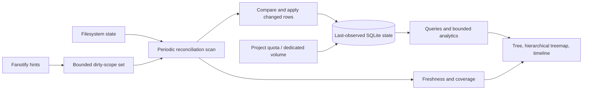

# Dux architecture and production readiness development specification

Status: final draft for implementation, 2026-10-29. Completion is evidence-gated.

## 1. Scope and authority

This specification turns the current-code review into development requirements.
It is part of the existing production-readiness goal through
[`PRODUCTION_READINESS_AUDIT.md`](../PRODUCTION_READINESS_AUDIT.md), which remains
the execution and evidence ledger. It extends, and does not replace, that goal's
live accounting, fault recovery, scale, packaging/security, operations, 72-hour
dedicated endurance and 24-hour canary gates.

Related designs: [`ARCHITECTURE_EVOLUTION.md`](ARCHITECTURE_EVOLUTION.md) and
[`PATH_IDENTITY_V6.md`](PATH_IDENTITY_V6.md), now targeting schema v7 after the
v6 growth-history migration. Where those documents imply that
journal sequences alone establish an exact filesystem snapshot or that every
overflow can be scoped narrowly, the explicit limits in this specification apply.

### Architecture decision amendment — 2026-11-07

The accepted default is now **reconciliation-first**: scans define the
last-observed index; fanotify provides bounded dirty-directory hints. This
supersedes the journal-first target and delivery order below. Journal design,
sequence replay, and provisional event overlays are deferred to an optional
low-latency profile. Requirements for path identity, exact accounting against
quiescent filesystem truth, bounded storage/resources, truthful coverage,
security, packaging, scale, and endurance remain in force. Freshness is an
observed-age SLO, not a claim that a live scan is an atomic snapshot.

Preserve existing user work and exact source/binary evidence. Qualification VMs
must use 2–4 GiB RAM, pass host admission/pressure guards, and retain explicit
worker budgets. Tests operate on disposable fixtures. A new candidate does not
inherit qualification from a different executable. Production rollout follows
qualification and requires concrete rollback artifacts.

## 2. Current evidence and problems

This table records the review baseline; subsequent implementation and verification
are recorded in the readiness audit rather than changing the baseline findings.

| ID | Priority | Observed source/evidence | Required outcome |
| --- | --- | --- | --- |
| DB-01 | P0 | rusqlite 0.32.1 bundles SQLite 3.46.0, in the upstream WAL-reset affected range | Bundle and verify an upstream fixed SQLite version; qualify backup, readers, writers and checkpoints |
| CAP-01 | P0 | Watcher resolves events and performs SQLite flushes on its ingestion path | Prompt capture proceeds independently of slow apply/reconcile work |
| ID-01 | P0 | Active schema v5 uses inode identity for directory parents; mount aliases collapse | Represent all visible path instances separately from physical object allocation |
| HIST-01 | P0 correctness | Growth primary key omits object incarnation | Reused inode numbers never inherit unrelated retained history |
| APPLY-01 | P1 | Churn run recorded 8.6–19.2 second flushes, before host-pressure stop | Profile stages, remove unnecessary work, and meet calibrated convergence budgets |
| APPLY-02 | P1 | `Option::or(indexed_path(...)?)` eagerly queries fallback on delete paths | Query indexed parents only when filesystem identity is unavailable |
| WAL-01 | P1 | journal_size_limit plus PASSIVE checkpoint is treated as a size backstop | Account for pinned readers and implement observable bounded-space behavior |
| UI-01 | P1 | Large-file query groups retained growth and uses OFFSET; treemap is page-local | Indexed pagination, cancellable analytics and a whole-scope hierarchical treemap |
| ERR-01 | P1 | Some mapped SQL rows discard errors | Exact results fail visibly or explicitly report partial coverage |
| STORAGE-01 | P1 | Approximately 74 GiB readiness artifacts, including 57 GiB VM images | Ownership manifests, retention classes, capacity preflight and evidence-preserving reclamation |
| MOD-01 | P2 | Watcher/UI combine several responsibilities; optional tunnel has fixed endpoints | Stable module boundaries and separately configured optional remote access |

DB-01 is an additional release risk, not an established explanation for the live
drift. The precise APPLY-01 hotspot remains unproven until phase profiling.
Baseline artifacts and interrupted runs stay available; an incomplete checkpoint
does not count as a passed batch.

### DB-01 disposition update — 2026-11-03

The original dependency finding is fixed in the current source candidate:
`Cargo.lock` resolves rusqlite 0.41.1 and libsqlite3-sys 0.39.1, whose bundled
SQLite headers identify version 3.54.1. The candidate's static executable
contains the matching source ID, and
`store::tests::bundled_sqlite_includes_wal_reset_fix` passed with that runtime
identity and enforces the upstream fixed-version floor of 3.51.3. SQLite's
[WAL-reset advisory](https://www.sqlite.org/wal.html#walreset) identifies
3.51.3 and later as fixed.

**Production exposure remains open:** the installed static R16 executable
contains SQLite 3.46.0, which is in the affected range. The newer candidate has
not passed final package, live-index migration, rollback, and production rollout
gates, so the source fix must not be treated as deployed mitigation. This does
not prove the WAL-reset race occurred in production; it means production still
runs an affected engine version until a qualified replacement is installed.

Upstream constraints:

- [SQLite WAL-reset advisory](https://www.sqlite.org/wal.html#walreset): affected
  versions include 3.46.0; fixed versions include 3.51.3 and selected backports.
- [SQLite journal_size_limit](https://www.sqlite.org/pragma.html#pragma_journal_size_limit)
  controls retained file size at reset/checkpoint boundaries, not an unconditional
  limit on an active WAL pinned by readers.
- [SQLite WAL](https://www.sqlite.org/wal.html): transactions across separate WAL
  databases are not one atomic commit across those databases.

## 3. Target system

Retain Rust, SQLite's single writer, bounded scan handoff, background UI work,
and explicit fault injection. Scans update only changed rows and record
per-scope observation generations. A live scan is not an atomic filesystem
snapshot; expose mixed observation ages instead of claiming a globally exact
publication instant. Start with separate workers in one process; introduce a
privileged helper only after its capability and file-descriptor protocol is
specified and qualified.

### 3.1 Event hints and scan scheduling

- Fanotify validates enough event structure to identify a filesystem and
  candidate parent scope, then adds a bounded/coalesced hint. The reader does
  no per-file handle resolution, SQLite writes, or recursive traversal.
- Hints prioritize scans; they never define file size or correctness. An
  unresolved parent widens the hint to a resolvable ancestor or the filesystem.
- Kernel overflow schedules a full filesystem scan. If events continue to
  exceed drain capacity, freshness degrades visibly while scans remain
  automatically scheduled; overflow must not open a permanent retry circuit.
- A timer schedules full scans independently of event activity and daemon
  uptime. Critical pressure may defer work with bounded backoff, but the status
  reports missed freshness targets and the next retry.
- A durable journal is not part of the default architecture. Reintroduce it
  only for a separate profile with a measured downtime-loss requirement.

### 3.2 Identity, paths and historical attribution

- Give each object incarnation a durable internal ID. Device/inode, filesystem
  identity, mount epoch and available birth/generation evidence identify or
  validate that incarnation. Missing birth evidence must have an explicit reuse
  policy; do not assume inode numbers are permanent identities across reboot.
- Each visible path occurrence has its own parent path ID and mount identity.
  Aliases and hardlinks reference object IDs. Preserve byte-exact names;
  lossy display strings must never become identity or mutation inputs.
- Define visible subtree allocation, globally attributed unique allocation,
  logical file length and filesystem capacity separately. Aliased visible totals
  may overlap. Canonical attribution is not a general independently deduplicated
  total for every subtree; any such query needs its own explicit algorithm.
- History references incarnation IDs, with first/last observation and sufficient
  historical path attribution to explain moves/deletions. Unknown past attribution
  remains unknown. Legacy ambiguous history must not be relabeled as exact.
- Migration builds privately, preserves the old readable generation, verifies
  paths/objects/rollups/history and publishes atomically. Downgrade/rollback uses
  a matching executable/database pair; schema constants alone do not enable v6.

### 3.3 Apply and accounting

- Compare observed stat tuples to existing rows and batch only changed rows.
  Keep filesystem traversal separate from SQLite commit work so one slow writer
  does not halt the next scheduled scan.
- Give visible path instances and physical inode incarnations distinct
  identities. Preserve hardlink allocation deduplication, non-UTF8 names,
  inode reuse protection, and explicit ambiguity when identity is insufficient.
- Compute old/new edge contributions transactionally; combine ancestor deltas
  and write each total once. A changed file may update its ancestor chain, but
  ordinary updates must not rescan unrelated siblings.
- Directory removals require a complete enumeration of that parent. On
  traversal or SQL failure, keep the previous rows and mark that scope incomplete.
- Record scan duration, stat calls, rows visited/changed, commit/fsync cost,
  observation age, missed cadence, and resource pressure. Include failed phases
  and rate-limit diagnostics. Batch limits adapt within measured latency/memory
  bounds.

### 3.4 Reconciliation and publication

- Persist per-filesystem and per-directory scan generation, observation time,
  progress, and coverage errors. Prioritize hinted scopes and the oldest
  observation, with a periodic full traversal as the missed-hint backstop.
- Compare stat tuples and update changed rows. Remove stale rows only after
  their parent directory has been completely and successfully enumerated.
  Interrupted or unreadable scopes preserve the previous rows and report
  incomplete coverage.
- Concurrent mutation can make the index a set of last observations from
  different times. Do not publish a global `exact` or `caught_up` claim from a
  successful walk alone. Filesystem snapshots may provide a stronger
  point-in-time profile when available.
- Automatic retries continue after bounded backoff; no attempt-count circuit
  permanently disables scans. Readers receive freshness age, scan progress,
  coverage status, and any missed SLO. A heartbeat alone never proves coverage.

### 3.5 Queries, history and UI

- Fetch only data needed for the visible screen. Separate navigation, health,
  size ranking and historical aggregation. Cancel superseded requests promptly.
- Use deterministic cursor pagination tied to scope/order/data generation.
  Size-ranked pages select from allocation indexes before aggregating history
  for their selected objects. Measure growth ranking separately.
- Cache with data generation and scope keys; bound memory and reader lifetime.
  Propagate row/query failures rather than quietly dropping records.
- Implement a hierarchical area-proportional treemap covering the selected
  scope: directory tiles, drill-down, aggregated small-file tiles and explicit
  alias overlap. A top-page treemap must remain labeled as such.
- All-files view supports allocated size, logical length, path, owner, age,
  filesystem and retained growth. Timeline reports retained resolution and
  coverage; modification time is not the time at which disk growth occurred.

### 3.6 Storage, WAL and artifact ownership

- Budget committed index, staging generations, journal, WAL, history, logs and
  qualification artifacts individually and together. Include free inodes and
  space needed for recovery/publication in admission decisions.
- Observe checkpoint return values/progress and reader ages. Expire/cancel
  Dux-owned long readers before they pin unsafe WAL growth. External readers
  require visible operator action; never truncate a live WAL manually.
- Run bounded history pruning on a maintenance schedule, not for every event
  commit. Tier five-minute history into hourly/daily summaries under byte and
  age budgets. Deleting rows does not necessarily shrink allocated DB size;
  reclamation must be measured and scheduled with adequate headroom.
- If history is separated into another file, use committed sequence/catch-up
  metadata and explicitly tolerate analytics lag. Do not claim cross-file atomic
  publication without a proven protocol.
- Artifact manifests record owner, source/binary/fixture hashes, allocated and
  apparent bytes, purpose, retention class and consumers. Deduplicate immutable
  binaries; compress or offload inactive images after verification. Disposable
  fixtures have expiry, capacity preflight and cleanup. Preserve evidence for
  unresolved failures and rollback; no blanket deletion of readiness folders.
- Automated reclamation defaults to disposable Dux-owned data. User-file cleanup
  requires explicit allowlists, dry-run identity checks, mount/symlink/race
  safeguards, durable audit and quarantine where practical.

### 3.7 Modules, privileges and deployment

- Separate event hints, scan scheduling/walking, comparison/writes, health,
  queries and presentation behind narrow typed interfaces. Do not add a journal
  to the default profile.
- Keep the independent reference model and replay traces simpler than production
  logic. Avoid replacing SQLite or introducing distributed infrastructure without
  a measured requirement.
- Optional SSH/tunnel functionality moves toward a separately configured package
  or executable with no embedded operator endpoints. Default indexing grants no
  remote access and creates no remote-access identity.
- Retain default index confidentiality and qualified filesystem visibility.
  Privilege reduction must not silently hide paths through namespace changes.

## 4. Delivery sequence and acceptance

| Stage | Work | Required evidence before completion |
| --- | --- | --- |
| S0 | Qualify bounded automatic retry for the existing reconciliation circuit and diagnose CPU-throttle/overflow correlation under a matched trace | Repeated runs show automatic recovery or a clear terminal cause; compare event rates, overflow count, CPU/I/O, and scan recovery. No production setting change without rollback evidence. |
| S1 | Establish schema-v7 path identity before implementing general incremental reconciliation | Aliases, hardlinks, inode reuse, non-UTF8 names, history, and rollups agree with independent truth; migration preserves a matching rollback pair. |
| S2 | Specify last-observed freshness and implement periodic full reconciliation with changed-row writes | Under quiescence, exact path/allocation/rollup agreement with independent truth; under churn, stale values are labeled and each completed directory observation has a generation/time. |
| S3 | Add bounded, coalesced fanotify hints and overflow-to-scan scheduling | Forced kernel overflow and hint-capacity saturation both recover automatically; no event is required to clear a permanent retry circuit; unresolved coverage remains visible. |
| S4 | Measure cadence and resource use on 1.37M-entry production-shaped fixtures and representative load | Per-scope observation age, full-walk time, CPU, I/O, memory, changed-row writes, and missed cycles satisfy the measured freshness/resource SLO. |
| S5 | Qualify optional ext4/XFS project quota or dedicated-volume reporting for managed build trees | Independent block/inode accounting agrees for supported operations; project setup and hardlink/rename boundary semantics are tested on disposable filesystems. |
| S6 | Package, security, operations, and integrated release qualification | Exact candidate passes P0, scale, overflow/reconciliation, low-disk, 72-hour endurance, and 24-hour canary gates with rollback artifacts; UI labels last-observed age accurately. |

Stages may overlap only when dependencies and exact build identity remain clear.
Each change records implemented, verified, incomplete and failed outcomes. A
passing old candidate or small unit test does not close an integrated release gate.

### Prototype state (2026-11-07)

The opt-in `dux daemon --reconcile-first` path implements the first runtime
slice of S2/S3: bounded fanotify metadata draining without path resolution,
overflow-to-reconciliation requests, 15-minute full-scan scheduling, and
last-observed status labeling. It currently uses full atomic index rebuilds;
changed-row writes, per-directory generations/freshness, incomplete-scope row
preservation, and production-scale cost measurements are still unimplemented.
The default daemon remains event-apply mode. Treat this prototype as
qualification-only until S2-S4 exit evidence is met.

## 5. Performance and reliability contract

Retain existing calibrated 100k/1m/10m release budgets, including actual process
RSS, scan/query/TUI latency, exact truth and worker/VM limits. Inspect the current
scale harness and audit before asserting numeric pass limits. Add measured
per-scope observation age, full-scan duration, dirty-hint-to-scan delay, changed
rows written, rows/stat calls visited, sustained mutation rate, missed cadence,
disk headroom and reader duration. Calibration records workload seed,
filesystem/kernel, guest and worker quotas, cache state, background load and
source/binary/configuration identities. Quota changes do not count as speedups.

The initial freshness target is a maximum **15-minute observation age** for
supported local filesystems under the named production workload. Scan cadence
must account for traversal duration and path order; a 15-minute start-to-start
timer alone does not establish a 15-minute maximum age. If the measured scan
rate cannot meet both freshness and resource budgets, the target must be
reported as missed or renegotiated from evidence, not silently weakened.

Current `scripts/dux-scale.py` gates use strict upper bounds:

| Measurement | 100k paths | 1m paths | 10m paths |
| --- | --- | --- | --- |
| Scan wall time | 30 s | 180 s | 1,800 s |
| Actual scan process peak RSS | 256 MiB | 256 MiB | 256 MiB |
| Query p95 | 1 s for each measured query | 1 s for each measured query | top dirs/files and metrics 0.5 s; unique find 3 s; depth-1 du 1 s; growth 5 s |
| TUI input acknowledgement p95 | 100 ms | 100 ms | 100 ms |
| TUI quit p95 | 250 ms | 250 ms | 250 ms |

These are acceptance limits, not claims of current performance. New capture,
replay, hierarchical UI and storage measurements need calibrated limits before
their respective stages can close. Reference-profile changes require recorded
justification; they cannot silently relax a failing gate.

Fault acceptance includes actual fanotify overflow, interrupted scans, concurrent
create/write/rename/delete, permission/capability loss, cgroup OOM/restart, mount
topology changes, ENOSPC/read-only storage, held readers, interrupted upgrades,
and recovery after pressure. After quiescence, exactness covers paths,
incarnations, allocations, directory totals, and history. During concurrent
mutation, freshness and coverage claims must match the per-scope observation data,
not only SQLite structural integrity.

The production-readiness goal is complete only after every original gate and
this specification's applicable requirements have authoritative pass evidence.
No maturity percentage or delivery date is inferred from lines changed or test
counts. The execution ledger must state the remaining work directly.
