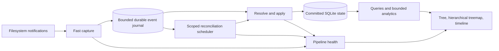

# Dux architecture and production readiness development specification

Status: final draft for implementation, 2026-10-29. Completion is evidence-gated.

## 1. Scope and authority

This specification turns the current-code review into development requirements.
It is part of the existing production-readiness goal through
[`PRODUCTION_READINESS_AUDIT.md`](../PRODUCTION_READINESS_AUDIT.md), which remains
the execution and evidence ledger. It extends, and does not replace, that goal's
live accounting, fault recovery, scale, packaging/security, operations, 72-hour
dedicated endurance and 24-hour canary gates.

Related designs: [`ARCHITECTURE_EVOLUTION.md`](ARCHITECTURE_EVOLUTION.md) and
[`PATH_IDENTITY_V6.md`](PATH_IDENTITY_V6.md), now targeting schema v7 after the
v6 growth-history migration. Where those documents imply that
journal sequences alone establish an exact filesystem snapshot or that every
overflow can be scoped narrowly, the explicit limits in this specification apply.

Preserve existing user work and exact source/binary evidence. Qualification VMs
must use 2–4 GiB RAM, pass host admission/pressure guards, and retain explicit
worker budgets. Tests operate on disposable fixtures. A new candidate does not
inherit qualification from a different executable. Production rollout follows
qualification and requires concrete rollback artifacts.

## 2. Current evidence and problems

This table records the review baseline; subsequent implementation and verification
are recorded in the readiness audit rather than changing the baseline findings.

| ID | Priority | Observed source/evidence | Required outcome |
| --- | --- | --- | --- |
| DB-01 | P0 | rusqlite 0.32.1 bundles SQLite 3.46.0, in the upstream WAL-reset affected range | Bundle and verify an upstream fixed SQLite version; qualify backup, readers, writers and checkpoints |
| CAP-01 | P0 | Watcher resolves events and performs SQLite flushes on its ingestion path | Prompt capture proceeds independently of slow apply/reconcile work |
| ID-01 | P0 | Active schema v5 uses inode identity for directory parents; mount aliases collapse | Represent all visible path instances separately from physical object allocation |
| HIST-01 | P0 correctness | Growth primary key omits object incarnation | Reused inode numbers never inherit unrelated retained history |
| APPLY-01 | P1 | Churn run recorded 8.6–19.2 second flushes, before host-pressure stop | Profile stages, remove unnecessary work, and meet calibrated convergence budgets |
| APPLY-02 | P1 | `Option::or(indexed_path(...)?)` eagerly queries fallback on delete paths | Query indexed parents only when filesystem identity is unavailable |
| WAL-01 | P1 | journal_size_limit plus PASSIVE checkpoint is treated as a size backstop | Account for pinned readers and implement observable bounded-space behavior |
| UI-01 | P1 | Large-file query groups retained growth and uses OFFSET; treemap is page-local | Indexed pagination, cancellable analytics and a whole-scope hierarchical treemap |
| ERR-01 | P1 | Some mapped SQL rows discard errors | Exact results fail visibly or explicitly report partial coverage |
| STORAGE-01 | P1 | Approximately 74 GiB readiness artifacts, including 57 GiB VM images | Ownership manifests, retention classes, capacity preflight and evidence-preserving reclamation |
| MOD-01 | P2 | Watcher/UI combine several responsibilities; optional tunnel has fixed endpoints | Stable module boundaries and separately configured optional remote access |

DB-01 is an additional release risk, not an established explanation for the live
drift. The precise APPLY-01 hotspot remains unproven until phase profiling.
Baseline artifacts and interrupted runs stay available; an incomplete checkpoint
does not count as a passed batch.

### DB-01 disposition update — 2026-11-03

The original dependency finding is fixed in the current source candidate:
`Cargo.lock` resolves rusqlite 0.41.1 and libsqlite3-sys 0.39.1, whose bundled
SQLite headers identify version 3.54.1. The candidate's static executable
contains the matching source ID, and
`store::tests::bundled_sqlite_includes_wal_reset_fix` passed with that runtime
identity and enforces the upstream fixed-version floor of 3.51.3. SQLite's
[WAL-reset advisory](https://www.sqlite.org/wal.html#walreset) identifies
3.51.3 and later as fixed.

**Production exposure remains open:** the installed static R16 executable
contains SQLite 3.46.0, which is in the affected range. The newer candidate has
not passed final package, live-index migration, rollback, and production rollout
gates, so the source fix must not be treated as deployed mitigation. This does
not prove the WAL-reset race occurred in production; it means production still
runs an affected engine version until a qualified replacement is installed.

Upstream constraints:

- [SQLite WAL-reset advisory](https://www.sqlite.org/wal.html#walreset): affected
  versions include 3.46.0; fixed versions include 3.51.3 and selected backports.
- [SQLite journal_size_limit](https://www.sqlite.org/pragma.html#pragma_journal_size_limit)
  controls retained file size at reset/checkpoint boundaries, not an unconditional
  limit on an active WAL pinned by readers.
- [SQLite WAL](https://www.sqlite.org/wal.html): transactions across separate WAL
  databases are not one atomic commit across those databases.

## 3. Target system

Retain Rust, SQLite's single committed writer, bounded scan handoff, atomic
publication, background UI work and explicit fault injection. Start with
separate workers in one process; introduce a privileged collector helper only
after its capability and file-descriptor protocol is specified and qualified.

### 3.1 Capture and journal

- Capture validates records, assigns stream/epoch/sequence identities and
  appends compact records. No SQL, recursive traversal or UI work belongs here.
- Version and checksum journal records/segments. Record mount/coverage epochs,
  raw names/handles, masks, sequence, and gaps. Specify segment recovery after
  torn writes and compatibility across upgrades.
- Group commits have an explicit maximum durability window and byte bound.
  Publish captured versus durable sequence separately. Reserve capture progress
  within the whole-service resource limit; no unbounded memory or disk queues.
- Persist the applied cursor in the same index transaction as its state changes.
  Reclaim segments only after committed application and all required recovery
  consumers release them. Replay is idempotent and handles duplicate records.
- Journal exhaustion and kernel overflow invalidate coverage. If the origin
  cannot be narrowed, dirty all affected marks/filesystems, not a guessed subtree.
  Reserve metadata capacity for gaps; if gap persistence fails, next startup
  treats the stream as unclean and performs conservative recovery.
- A journal cannot cover capture downtime or guarantee that a deleted object's
  handle still resolves. Missing identity is explicit uncertainty requiring
  reconciliation. Do not advertise uninterrupted exactness from local replay.

### 3.2 Identity, paths and historical attribution

- Give each object incarnation a durable internal ID. Device/inode, filesystem
  identity, mount epoch and available birth/generation evidence identify or
  validate that incarnation. Missing birth evidence must have an explicit reuse
  policy; do not assume inode numbers are permanent identities across reboot.
- Each visible path occurrence has its own parent path ID and mount identity.
  Aliases and hardlinks reference object IDs. Preserve byte-exact names;
  lossy display strings must never become identity or mutation inputs.
- Define visible subtree allocation, globally attributed unique allocation,
  logical file length and filesystem capacity separately. Aliased visible totals
  may overlap. Canonical attribution is not a general independently deduplicated
  total for every subtree; any such query needs its own explicit algorithm.
- History references incarnation IDs, with first/last observation and sufficient
  historical path attribution to explain moves/deletions. Unknown past attribution
  remains unknown. Legacy ambiguous history must not be relabeled as exact.
- Migration builds privately, preserves the old readable generation, verifies
  paths/objects/rollups/history and publishes atomically. Downgrade/rollback uses
  a matching executable/database pair; schema constants alone do not enable v6.

### 3.3 Apply and accounting

- Coalesce only where operation equivalence is proven. Preserve ordering across
  rename, deletion, hardlink, incarnation and gap boundaries.
- Resolve shared ancestors once within a validated transaction scope. Use lazy
  fallback, prepared statements and set-based staging where measurements justify
  them. Bound caches and invalidate them on relevant graph changes.
- Compute old/new edge contributions transactionally; combine ancestor deltas
  and write each total once. Ordinary changes must not scan unrelated siblings.
- Expensive exact rollup repair is scoped and budgeted. Keep the existing exact
  checks until replacement accounting passes differential churn/replay tests.
- Record phase duration, operation count, rows visited, commit/fsync cost,
  retries, queue age and dropped/uncertain work. Include failed phases, and rate
  limit diagnostics. Batch limits adapt within measured latency/memory bounds.

### 3.4 Reconciliation and publication

- Persist dirty scope, reason, generation, coverage epoch and retry state.
  Local trustworthy evidence permits local repair; ambiguous cross-scope moves
  and broad gaps widen the repair domain.
- Prioritize age, user impact and estimated work. Reserve minimum recovery
  progress; broad audits, compaction and optional analytics yield first.
- A scan uses a private generation and known capture boundaries. Replay and
  verify before publication. Scan order plus sequence numbers does not establish
  an atomic filesystem snapshot: use native snapshots when available, otherwise
  specify convergence/quiescence checks and expose their verification interval.
- Readers pin one committed generation. Freshness describes scope coverage,
  durable/applied/verified sequence, lag, cause and next retry. A heartbeat alone
  never proves correctness. Provisional overlays are optional and clearly
  distinguished from committed values; implement only after replay is sound.

### 3.5 Queries, history and UI

- Fetch only data needed for the visible screen. Separate navigation, health,
  size ranking and historical aggregation. Cancel superseded requests promptly.
- Use deterministic cursor pagination tied to scope/order/data generation.
  Size-ranked pages select from allocation indexes before aggregating history
  for their selected objects. Measure growth ranking separately.
- Cache with data generation and scope keys; bound memory and reader lifetime.
  Propagate row/query failures rather than quietly dropping records.
- Implement a hierarchical area-proportional treemap covering the selected
  scope: directory tiles, drill-down, aggregated small-file tiles and explicit
  alias overlap. A top-page treemap must remain labeled as such.
- All-files view supports allocated size, logical length, path, owner, age,
  filesystem and retained growth. Timeline reports retained resolution and
  coverage; modification time is not the time at which disk growth occurred.

### 3.6 Storage, WAL and artifact ownership

- Budget committed index, staging generations, journal, WAL, history, logs and
  qualification artifacts individually and together. Include free inodes and
  space needed for recovery/publication in admission decisions.
- Observe checkpoint return values/progress and reader ages. Expire/cancel
  Dux-owned long readers before they pin unsafe WAL growth. External readers
  require visible operator action; never truncate a live WAL manually.
- Run bounded history pruning on a maintenance schedule, not for every event
  commit. Tier five-minute history into hourly/daily summaries under byte and
  age budgets. Deleting rows does not necessarily shrink allocated DB size;
  reclamation must be measured and scheduled with adequate headroom.
- If history is separated into another file, use committed sequence/catch-up
  metadata and explicitly tolerate analytics lag. Do not claim cross-file atomic
  publication without a proven protocol.
- Artifact manifests record owner, source/binary/fixture hashes, allocated and
  apparent bytes, purpose, retention class and consumers. Deduplicate immutable
  binaries; compress or offload inactive images after verification. Disposable
  fixtures have expiry, capacity preflight and cleanup. Preserve evidence for
  unresolved failures and rollback; no blanket deletion of readiness folders.
- Automated reclamation defaults to disposable Dux-owned data. User-file cleanup
  requires explicit allowlists, dry-run identity checks, mount/symlink/race
  safeguards, durable audit and quarantine where practical.

### 3.7 Modules, privileges and deployment

- Separate capture, journal, reducer, accounting, reconciliation, publication,
  health, queries and presentation behind narrow typed interfaces.
- Keep the independent reference model and replay traces simpler than production
  logic. Avoid replacing SQLite or introducing distributed infrastructure without
  a measured requirement.
- Optional SSH/tunnel functionality moves toward a separately configured package
  or executable with no embedded operator endpoints. Default indexing grants no
  remote access and creates no remote-access identity.
- Retain default index confidentiality and qualified filesystem visibility.
  Privilege reduction must not silently hide paths through namespace changes.

## 4. Delivery sequence and acceptance

| Stage | Work | Required evidence before completion |
| --- | --- | --- |
| S0 | Baseline telemetry, patched SQLite, lazy lookup, explicit SQL errors | Actual engine version recorded; native/musl compile and relevant database/reducer regressions pass; independent before/after throughput evidence |
| S1 | Object incarnation/history and path-instance schema | Reuse, hardlinks, aliases, non-UTF8 names, moves/deletions, migration and rollback all exact against independent truth |
| S2 | Journal and separate capture/apply | Replay equivalence, duplicate/torn records, crash boundaries, capacity/gaps, slow writer and unresolvable handles qualified |
| S3 | Scoped recovery and incremental accounting | Local repair avoids unrelated traversal; ambiguous loss escalates; concurrent mutations recover; exact rollups/history and bounded progress under pressure |
| S4 | UI, query cancellation, tiered history and owned-storage budgets | Whole-scope treemap reconciles with selected totals; pagination/filter correctness; history coverage; query/reader/WAL/storage limits measured |
| S5 | Modules, package/security and operations | Native/musl packages; supported-platform lifecycle; default privileges; monitoring/runbooks; matching rollback bundle |
| S6 | Integrated release qualification | Final-candidate P0 plus all scale budgets, 72-hour dedicated endurance and 24-hour canary actually pass |

Stages may overlap only when dependencies and exact build identity remain clear.
Each change records implemented, verified, incomplete and failed outcomes. A
passing old candidate or small unit test does not close an integrated release gate.

## 5. Performance and reliability contract

Retain existing calibrated 100k/1m/10m release budgets, including actual process
RSS, scan/query/TUI latency, exact truth and worker/VM limits. Inspect the current
scale harness and audit before asserting numeric pass limits. Add measured
capture-to-durable, durable-to-applied and scope-to-verified p50/p95/p99 latency,
sustained mutation throughput, maximum backlog age, write amplification, disk
headroom, rows visited and reader duration. Calibration records workload seed,
filesystem/kernel, guest and worker quotas, cache state, background load and
source/binary/configuration identities. Quota changes do not count as speedups.

Current `scripts/dux-scale.py` gates use strict upper bounds:

| Measurement | 100k paths | 1m paths | 10m paths |
| --- | --- | --- | --- |
| Scan wall time | 30 s | 180 s | 1,800 s |
| Actual scan process peak RSS | 256 MiB | 256 MiB | 256 MiB |
| Query p95 | 1 s for each measured query | 1 s for each measured query | top dirs/files and metrics 0.5 s; unique find 3 s; depth-1 du 1 s; growth 5 s |
| TUI input acknowledgement p95 | 100 ms | 100 ms | 100 ms |
| TUI quit p95 | 250 ms | 250 ms | 250 ms |

These are acceptance limits, not claims of current performance. New capture,
replay, hierarchical UI and storage measurements need calibrated limits before
their respective stages can close. Reference-profile changes require recorded
justification; they cannot silently relax a failing gate.

Fault acceptance includes actual overflow; crashes at journal/index/publication
boundaries; permission/capability loss; cgroup OOM/restart; mount topology;
ENOSPC/read-only storage; held readers; interrupted upgrades; and recovery after
pressure. Exactness covers paths, incarnations, allocations, directory totals,
history and explicit uncertainty, rather than only SQLite structural integrity.

The production-readiness goal is complete only after every original gate and
this specification's applicable requirements have authoritative pass evidence.
No maturity percentage or delivery date is inferred from lines changed or test
counts. The execution ledger must state the remaining work directly.
